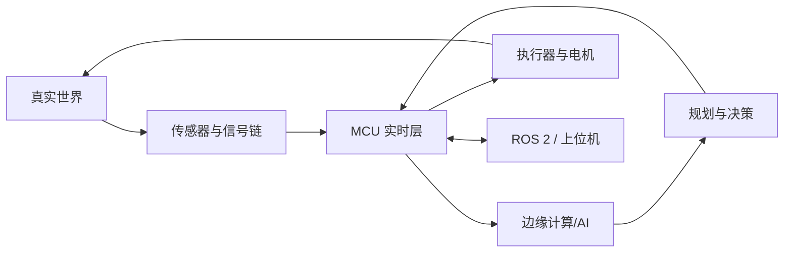

# 物理 AI 嵌入式学习地图

> [!abstract] 目标
> 学会构建能够**感知环境、实时决策并安全执行动作**的物理系统。嵌入式开发不是孤立的“点灯技术”，而是物理 AI 的神经与肌肉层。

## 系统全景

物理 AI 的核心闭环是：

1. **感知**：相机、IMU、编码器、力/触觉、距离、温度等传感器。
2. **估计**：滤波、标定、时间同步、状态估计。
3. **决策**：状态机、规划器、传统控制或学习模型。
4. **执行**：电机、舵机、机械臂、阀、继电器。
5. **安全**：限位、急停、看门狗、降级和故障恢复。

## 学习主线

- [[01-物理AI系统分层与硬件选择]]
- [[02-C语言与MCU实时基础]]
- [[03-传感器与信号链]]
- [[04-执行器与电机控制]]
- [[05-实时系统与FreeRTOS]]
- [[06-机器人通信总线]]
- [[07-控制与状态估计基础]]
- [[08-边缘AI与TinyML部署]]
- [[09-ROS2与MCU协同]]
- [[10-安全可靠性与调试]]
- [[11-物理AI项目阶梯]]
- [[12-十二周学习计划]]

配套工具：

- [[实验记录模板]]
- [[项目设计模板]]
- [[物理AI官方资料索引]]

## 你应该优先掌握什么

### 第一优先级：可靠闭环

- 读取传感器并验证单位、量程、频率和噪声。
- 用定时器建立稳定周期，不依赖阻塞延时。
- 驱动执行器，同时处理饱和、限位和失控保护。
- 用日志、波形和故障现场定位问题。

### 第二优先级：系统协同

- MCU 与 Linux/边缘计算板通过 UART、CAN、USB 或 Ethernet 通信。
- 为每条数据附加时间戳、序号、单位和有效性。
- 将硬实时控制留在 MCU，将高算力感知和规划放在边缘端。

### 第三优先级：学习型能力

- 先建立可靠的数据管线和传统基线，再训练模型。
- 能测量模型的准确率、延迟、内存、功耗和最坏情况行为。
- 推理输出不能绕过安全约束直接驱动危险执行器。

## 毕业标准

完成一个带传感器、执行器、实时控制和边缘智能的系统，并能够回答：

- 控制周期的最坏执行时间和抖动是多少？
- 传感器断线、数据过期、通信中断时系统做什么？
- 模型不确定或输出异常时如何降级？
- 急停和限位是否独立于高层软件？
- 如何根据日志和固件版本复现一次故障？

