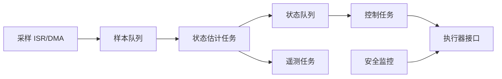

# 实时系统与 FreeRTOS

## 何时需要 RTOS

当采集、控制、通信、记录和 UI 有不同周期及阻塞行为时，RTOS 能提供清晰的调度与同步。系统简单时，协作式状态机通常更容易证明。

## 推荐任务划分

## 核心规则

- 高优先级任务等待事件，不忙等。
- 使用队列传递所有权清晰的消息，减少共享可变状态。
- 每个队列定义容量、满时策略和超时。
- 周期任务使用绝对节拍，减少漂移。
- 测量任务栈余量、运行时间、截止期限违约和 CPU 占用。
- ISR 使用对应的 `FromISR` API，并遵循优先级限制。

## 常见故障

- 高优先级任务一直 Ready，低优先级饥饿。
- 多把锁顺序不一致导致死锁。
- 在持锁期间做日志、网络或不可控阻塞。
- 队列满后永久等待，故障逐级传播。
- 看门狗在独立定时器中无条件喂，掩盖任务卡死。

## 实验

实现三个周期：

- 1 kHz：读取编码器并更新控制器。
- 100 Hz：融合 IMU/里程计。
- 10 Hz：串口或 CAN 遥测。

用 GPIO 翻转测量每个任务执行窗口和抖动。随后制造通信洪泛，验证 1 kHz 控制周期仍满足截止期限。

## 验收

- 能说明每个任务优先级的时序理由。
- 控制链路不依赖低优先级日志任务。
- 所有任务和队列都有运行时健康指标。

