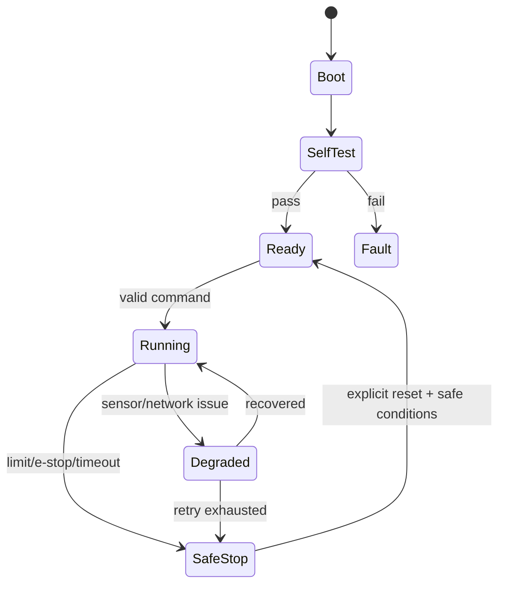

# 安全、可靠性与调试

物理 AI 的 bug 会造成真实运动、发热、碰撞和损坏。安全必须独立于模型准确率。

## 安全层级

1. **机械**：防护罩、限位、失效安全结构。
2. **电气**：保险、过流、过压、温度、硬件急停和驱动器故障脚。
3. **固件**：命令超时、范围检查、看门狗、状态机和安全默认值。
4. **高层**：规划约束、碰撞检测、模型置信度与权限。

高层崩溃时，底层仍应进入安全状态。

## 故障状态

## 可观测性

日志至少包含：时间、模块、事件、关键参数、固件版本、复位原因。HardFault 保存 PC/LR 和故障寄存器。对高频控制环使用计数器/事件记录，避免实时打印破坏时序。

## 系统化调试

1. 写出最小可重复现象。
2. 找到最后正确点和第一个错误点。
3. 列出 3 个假设和区分实验。
4. 一次只改一个变量，保存日志/寄存器/波形。
5. 修复根因并增加回归测试。

## 必做故障注入

- 传感器断线、卡死和数据冻结。
- 编码器方向反、计数跳变。
- 通信半包、错误 CRC、延迟和断线。
- 任务超时、队列满、栈不足。
- 模型输出 NaN、越界或低置信度。
- 电池电压低、驱动器过温、急停触发。

## 上电与动作安全清单

- [ ] 上电默认执行器关闭或零转矩。
- [ ] 未完成自检不能进入运行态。
- [ ] 命令有超时和范围限制。
- [ ] 急停不依赖 ROS 2 或 AI 模型。
- [ ] 重新连接/重启不会自动恢复危险动作。
- [ ] 有物理断电手段，首次测试限制能量。

