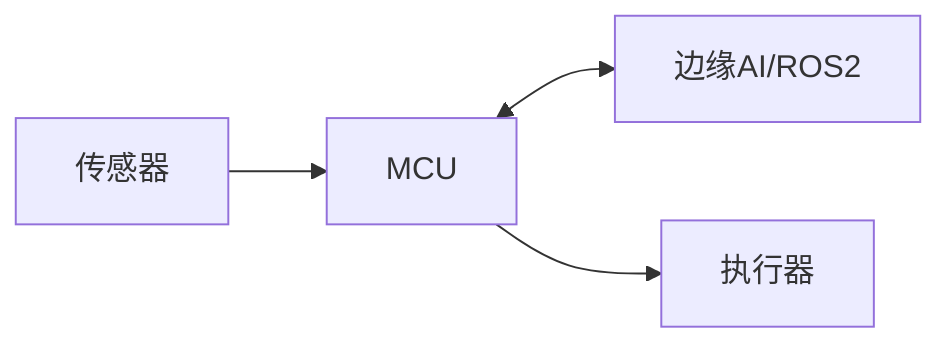

# 项目：{{title}}

## 问题与成功标准

- 使用场景：
- 用户/环境：
- 成功指标：
- 明确不做：

## 系统架构

### 职责边界

- MCU：
- 边缘端：
- ROS 2/上位机：

## 接口表

| 数据/命令 | 生产者 | 消费者 | 频率 | 单位/坐标系 | 超时行为 |
|---|---|---|---:|---|---|
| | | | | | |

## 实时与资源预算

| 模块 | 周期/截止期限 | 最大执行时间 | RAM | Flash | 失败后果 |
|---|---:|---:|---:|---:|---|
| | | | | | |

## 安全分析

| 危险 | 原因 | 检测 | 缓解 | 安全状态 |
|---|---|---|---|---|
| | | | | |

## 测试矩阵

- 正常功能：
- 边界输入：
- 传感器故障：
- 通信故障：
- 模型异常：
- 电源/温度：
- 长时间运行：

## 里程碑

- [ ] 单模块验证
- [ ] 最小闭环
- [ ] 故障处理
- [ ] 性能测量
- [ ] 长时间测试
- [ ] 文档与演示

